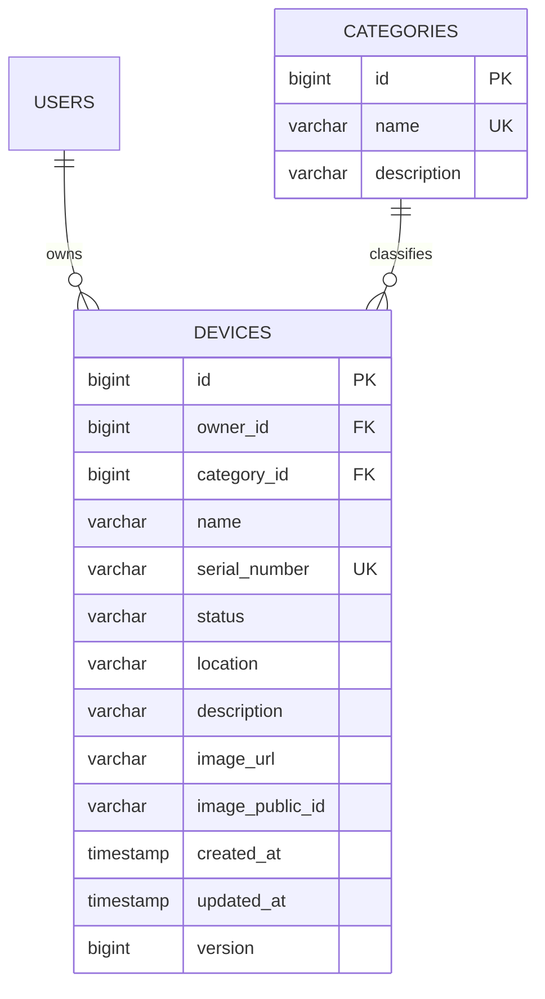
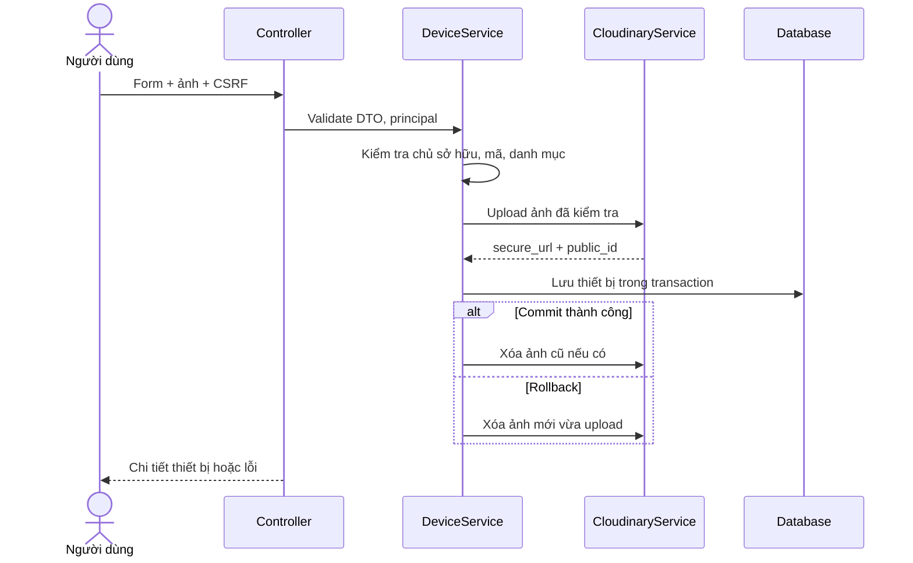

# Báo cáo module của Ngô Quang Đạt

## 1. Phạm vi hoàn thành

- Entity Device, Category; Repository; Service; REST Controller và MVC Controller.
- Thêm, xem danh sách/chi tiết, sửa, xóa thiết bị; tìm theo tên/mã; lọc danh mục và trạng thái; phân trang.
- Danh mục: Manager/Admin thêm, sửa, xóa; tất cả người dùng đã đăng nhập có vai trò phù hợp được đọc.
- Upload ảnh Cloudinary, xem trước ảnh, thay/xóa ảnh, kiểm tra dung lượng và nội dung file.
- Thymeleaf + Bootstrap 5: trang chủ, giao diện xác thực dùng chung layout, danh sách, chi tiết, form thiết bị và quản lý danh mục.
- Kiểm thử tích hợp HTTP–Security–Service–JPA bằng H2; tài liệu API, kịch bản demo và Postman Collection.

Phần OTP/User Management thuộc Bảo, thu thập dữ liệu/WebSocket/biểu đồ thuộc Đăng. Trạng thái thiết bị trong module này là trạng thái quản lý do người dùng chọn, không phải tín hiệu online/offline realtime.

## 2. Cách chạy

### Chạy trên máy Đạt sau khi cài MySQL

MySQL cần chạy dịch vụ `MySQL80`. Cấu hình riêng của máy nằm ở
`config/application-local.properties` (đã được bỏ qua trong Git).
Thay `CHANGE_ME` tại dòng `spring.datasource.password` bằng mật khẩu root đã đặt khi cài MySQL.

Trong PowerShell:

```powershell
cd D:\CEH\iot-device-management
.\start-local.ps1
```

Nếu chưa lưu mật khẩu vào file, script sẽ hỏi mật khẩu bằng ô nhập ẩn trong terminal;
mật khẩu này chỉ được truyền cho ứng dụng qua biến môi trường của tiến trình.
Script dùng file JAR đã build và profile `local`. Database `iot_management` được tạo
nếu chưa tồn tại, Hibernate tạo bảng khi ứng dụng khởi động thành công.
Trên máy Đạt, profile `local` dùng `server.port=8081` vì cổng 8080 đang bị chiếm.
Mở `http://localhost:8081`; giữ terminal chạy, nhấn Ctrl+C để dừng.

Cũng có thể chạy trực tiếp sau khi điền cấu hình:

```powershell
java -jar target/management-0.0.1-SNAPSHOT.jar --spring.profiles.active=local
```

### Cấu hình chung cho các máy khác

Project hiện dùng **Java 17, Spring Boot 2.7.18, Maven** theo `pom.xml`.

1. Tạo database MySQL `iot_management`.
2. Cấu hình kết nối bằng biến môi trường `SPRING_DATASOURCE_URL`, `SPRING_DATASOURCE_USERNAME`, `SPRING_DATASOURCE_PASSWORD` hoặc cấu hình local của nhóm.
3. Nếu cần ảnh, lấy thông tin từ Cloudinary Console và đặt biến môi trường trong terminal chạy ứng dụng:

```powershell
$env:CLOUDINARY_CLOUD_NAME = 'your-cloud-name'
$env:CLOUDINARY_API_KEY = 'your-api-key'
$env:CLOUDINARY_API_SECRET = 'your-api-secret'
mvn spring-boot:run
```

Không cần Cloudinary để chạy CRUD không kèm ảnh. Không đưa API secret vào Git. Ứng dụng không tự đọc `.env`; dùng biến môi trường của IDE/terminal. SMTP và tài khoản đăng nhập dùng luồng hiện có của module Bảo. Không tạo tài khoản admin mặc định.

Trên máy Đạt, có thể lưu ba thuộc tính `cloudinary.cloud-name`, `cloudinary.api-key`,
`cloudinary.api-secret` vào `config/application-local.properties` đã được Git bỏ qua.
Khởi động lại ứng dụng với profile `local` sau khi thay đổi cấu hình.

4. Mở `http://localhost:8080`. Đăng nhập bằng tài khoản đã xác thực. Nhờ thành viên quản lý tài khoản cấp role Manager/Admin cho tài khoản demo phù hợp.
5. Manager/Admin vào `/categories` tạo danh mục; User vào `/devices` thêm thiết bị.

Bootstrap được tải qua jsDelivr; cần mạng khi mở giao diện lần đầu. Upload ảnh thật cần mạng và tài khoản Cloudinary hợp lệ.

## 3. Thiết kế dữ liệu



`owner_id` luôn lấy từ principal đã xác thực, không nhận từ request. Mã thiết bị được trim và chuẩn hóa chữ hoa; không cho trùng. Category bắt buộc. Không cascade xóa User/Category khi xóa Device. FK và kiểm tra service ngăn xóa danh mục đang dùng. `@Version` phát hiện xung đột ghi đồng thời trong transaction; biểu mẫu hiện chưa kiểm tra phiên bản tại thời điểm người dùng mở form.

DTO DeviceResponse chỉ trả thông tin cần dùng; không serialize User/password/OTP hay public ID của Cloudinary. Index cho owner và category hỗ trợ lọc. Danh sách sắp xếp ngày tạo giảm dần rồi ID giảm dần.

## 4. Phân quyền và tích hợp Security

| Vai trò | Thiết bị | Danh mục |
|---|---|---|
| Chưa đăng nhập / Guest | Không được truy cập | Không được truy cập |
| User | CRUD của chính mình | Đọc danh sách/chi tiết qua API |
| Manager | CRUD của chính mình | CRUD dùng chung |
| Admin | CRUD toàn hệ thống | CRUD dùng chung |

Hiện schema chưa có vùng quản lý/quan hệ Manager–User, nên Manager chưa được xem thiết bị của người khác. Cần chốt schema với nhóm trước khi mở rộng quyền theo khu vực.

Truy cập ID của người khác trả 404, giống thiết bị không tồn tại. Khách vào trang web được chuyển đến `/login`, API trả 401. Lỗi phân quyền trả 403. Các đường dẫn mới yêu cầu role USER/MANAGER/ADMIN ở SecurityConfig và kiểm tra lại ở service.

JWT HttpOnly cookie hiện có tiếp tục dùng cho trình duyệt. Filter bổ sung hỗ trợ `Authorization: Bearer <token>` cho client API. Login hiện chỉ trả cookie, không trả token trong JSON. Với cookie, mọi thao tác ghi của module cần CSRF: lấy cookie `XSRF-TOKEN` từ một GET, gửi lại giá trị trong header `X-XSRF-TOKEN`. Form thường tự có `_csrf`; form multipart dùng JavaScript gửi token trong header trước khi MVC đọc file. Bearer không kèm cookie JWT được miễn CSRF. Thay đổi này chỉ áp dụng các đường dẫn thiết bị/danh mục, chưa thay chính sách CSRF của module auth cũ.

## 5. API

| Method | URL | Nội dung |
|---|---|---|
| GET | `/api/devices?q=&categoryId=&status=&page=0&size=10` | Danh sách có phân trang |
| GET | `/api/devices/{id}` | Chi tiết |
| POST | `/api/devices` | Thêm bằng JSON hoặc multipart/form-data |
| PUT | `/api/devices/{id}` | Cập nhật thông tin bằng JSON |
| POST | `/api/devices/{id}/image` | Multipart với field `image` |
| DELETE | `/api/devices/{id}` | Xóa thiết bị |
| GET | `/api/categories` hoặc `/api/categories/{id}` | Danh mục |
| POST | `/api/categories` | Thêm danh mục, JSON |
| PUT | `/api/categories/{id}` | Sửa danh mục, JSON |
| DELETE | `/api/categories/{id}` | Xóa danh mục chưa sử dụng |

Ví dụ DeviceRequest:

```json
{
  "name": "Cảm biến phòng khách",
  "serialNumber": "SENSOR-001",
  "categoryId": 1,
  "status": "ACTIVE",
  "location": "Tầng 1",
  "description": "Theo dõi nhiệt độ phòng",
  "removeImage": false
}
```

`status`: ACTIVE, INACTIVE, MAINTENANCE. `page` bắt đầu từ 0, `size` từ 1 đến 100. `q` tối đa 120 ký tự, tìm không phân biệt hoa thường trên tên hoặc mã; `%`, `_` được escape thành ký tự thường. Bộ lọc kết hợp bằng AND. JSON response danh sách có `content`, `totalElements`, `totalPages`, `number`, `size`.

POST multipart dùng các field cùng tên như JSON, thêm `image` kiểu file. PUT không có ảnh giữ nguyên ảnh; `removeImage=true` xóa ảnh. Với UI, nếu vừa chọn ảnh mới vừa đánh dấu xóa ảnh, ảnh mới được ưu tiên.

Tạo thành công: 201 + Location; xóa: 204. Dữ liệu sai: 400; không có quyền: 403; không tìm thấy: 404; trùng mã/tên hoặc FK/xung đột: 409; ảnh quá lớn: 413; lỗi Cloudinary: 502; chưa cấu hình Cloudinary: 503. Lỗi API có `error`, lỗi validation bổ sung `fields`.

## 6. Luồng ảnh Cloudinary



Ảnh JPG/PNG/GIF tối đa 5 MB, tối đa 25 megapixel. Kiểm tra bằng ImageIO, không tin phần mở rộng/MIME do client gửi. Ảnh lưu trong folder `iot-devices`; database lưu HTTPS URL và public ID để xóa đúng tài nguyên.

Database và Cloudinary không có transaction chung. Cleanup chạy sau transaction; khi dịch vụ ảnh không sẵn sàng, log `Cloudinary cleanup pending for public_id=...` phục vụ dọn thủ công. Chưa có hàng đợi retry bền vững; tiến trình dừng đột ngột sau upload vẫn có thể để lại ảnh mồ côi. Không khẳng định tính nguyên tử giữa hai hệ thống.

SDK và API được đối chiếu với [Cloudinary Java SDK](https://cloudinary.com/documentation/java_integration) và [Java upload](https://cloudinary.com/documentation/java_image_and_video_upload).

## 7. UI/UX

Header, thanh điều hướng workspace, footer, thông báo và badge trạng thái là fragment tái sử dụng. Bảng danh sách có tên/mã, thumbnail, danh mục, vị trí, trạng thái; Admin thêm cột chủ sở hữu. Bộ lọc được giữ khi đổi trang. Form hai cột trên desktop, xếp dọc trên điện thoại; bảng có cuộn ngang khi cần. Form hiển thị validation và giữ dữ liệu đã nhập. Có trạng thái rỗng, thông báo thành công, xác nhận xóa và xem trước ảnh. Menu danh mục chỉ hiện với Manager/Admin. Trang chủ và trang auth dùng cùng màu sắc/layout.

## 8. Kiểm thử và demo

```powershell
mvn test
mvn package
```

Test dùng H2 in-memory và mock Cloudinary, không gửi email hay upload thật. Kiểm tra CRUD, quyền chủ sở hữu/Admin/Manager, guest, JWT cookie/Bearer, CSRF, validation, mã trùng, lọc/phân trang, khóa ngoại danh mục, render Thymeleaf, escape HTML, rollback ảnh và kiểm tra file ảnh. HTML render phục vụ xem giao diện được ghi vào `target/ui-preview`.

Demo đề xuất:

1. Manager tạo danh mục Cảm biến.
2. User thêm thiết bị có ảnh; xem chi tiết và thumbnail.
3. Thêm vài thiết bị, tìm theo tên/mã, đổi trạng thái và phân trang.
4. Sửa thiết bị, thay ảnh, bỏ ảnh; thử mã trùng và ảnh sai định dạng.
5. User thứ hai thử truy cập ID của User đầu: 404. Admin thấy cả hai người dùng.
6. Thử xóa danh mục đang dùng: 409. Xóa thiết bị, sau đó xóa danh mục.

Ngày 15/10/2026, đã kiểm tra trên MySQL 8.0.46 và tài khoản Cloudinary cấu hình tại máy Đạt:
đăng nhập, CRUD thiết bị, tìm kiếm, tạo thiết bị multipart có ảnh, tải ảnh HTTPS,
thay ảnh và xóa thiết bị. Cloudinary Admin API xác nhận ảnh cũ bị xóa sau khi thay,
và toàn bộ ảnh kiểm tra không còn sau khi xóa thiết bị. Thiết bị/ảnh kiểm tra đã được dọn.
Các test Maven vẫn dùng H2 và mock Cloudinary; SMTP chưa được kiểm chứng.

Ngày 16/10/2026, đã triển khai bản sửa đóng luồng đọc ảnh sau validation để Windows
có thể xóa file upload tạm. Bộ kiểm thử đạt 12/12. Đã kiểm tra lại upload, tải ảnh,
thay ảnh và xóa thiết bị trên Cloudinary thật; xác nhận các ảnh thử đều được xóa
và log máy chủ không còn lỗi dọn file tạm.

Đăng có thể tham chiếu `Device.id` bằng FK từ DeviceData. Khi thêm dữ liệu lịch sử, nhóm cần chốt chính sách xóa thiết bị (chặn xóa, cascade dữ liệu lịch sử hoặc soft delete); hiện FK liên quan sẽ được báo thành lỗi xung đột.
